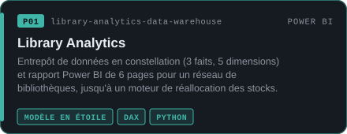
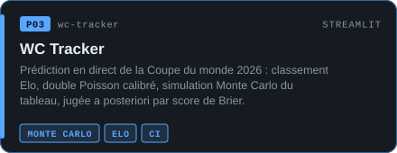
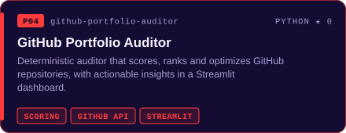
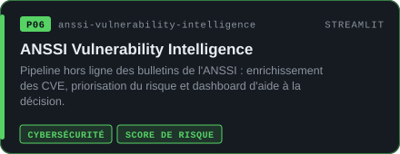
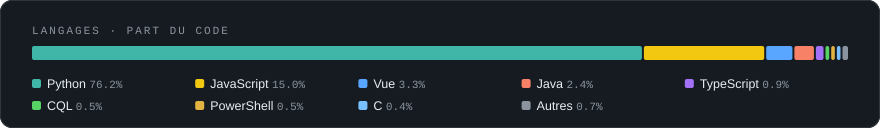

<!--
  Les images sous raw.githubusercontent.com/.../output/ sont générées chaque nuit
  par .github/workflows/profile-assets.yml à partir de profile.config.json.
  Modifier la config, pas les SVG.
  Chaque image est volontairement entourée d'un lien : sinon GitHub la rend
  cliquable et ouvre le proxy d'image brut.
-->

  <a href="https://www.linkedin.com/in/mathieu-alassoeur/">
    <picture>
      <source media="(prefers-color-scheme: light)" srcset="https://raw.githubusercontent.com/MatALass/MatALass/output/header-light.svg" />
      
    </picture>
  </a>

  

  
  
  

## À propos

Je suis en dernière année d'école d'ingénieur à l'**EFREI Paris** (majeure Business Intelligence & Analytics) et **Data Analyst en alternance dans l'équipe PMO d'Alpine Racing**. L'essentiel de mon travail, c'est la partie invisible qui rend un dashboard fiable : nettoyer des sources incohérentes, définir des indicateurs sur lesquels tout le monde s'accorde, et livrer des rapports réellement utilisés, dans les délais.

- **Aujourd'hui :** Data Analyst alternant, Alpine Racing, Viry-Châtillon
- **Avant :** Data Analyst stagiaire à l'International School of Management (Dortmund) : pipelines de qualité de données, synchronisation Targroup vers HubSpot par API, indicateurs académiques
- **À côté :** une suite d'analyse esport sur Valorant, un prédicteur de la Coupe du monde en direct, et un observatoire des audiences Twitch francophones (1,8 % des chaînes captent 80 % de l'audience en prime time)
- **Ensuite :** je cherche un **CDI de Data Analyst** en France à partir de **septembre 2027**. [Me contacter](mailto:mathieualassoeur@gmail.com)

## Stack

**Data & ML** 

**BI et visualisation** 

**Bases de données et API** 

**Backend et web** 

**Outils et déploiement** 

## Projets

  
  

  
  

  
  

### Esport et analyse sportive

| Projet | Ce qu'il fait | Stack |
| --- | --- | --- |
| **Twitch FR Observatory** (code privé, conditions de l'API Twitch) | Relevés planifiés des audiences Twitch francophones et analyse de concentration : 1,8 % des chaînes captent 80 % de l'audience en prime time | Python · OAuth2 · GitHub Actions · Power BI |
| [**VCT Meta Lens**](https://github.com/MatALass/vct-meta-lens) (dashboard Power BI en cours) | Évolution du méta Valorant pro sur la saison VCT 2025 : 15 tournois, 349 joueurs, plus de 100 000 kills, modélisés en étoile | Python · Parquet · Power BI |
| [**VCT Roster Analytics**](https://github.com/MatALass/vct-roster-analytics) | Effectifs VCT 2026 EMEA : scraping VLR.gg, z-scores normalisés par rôle, transferts, vivier Challengers, classement quotidien des équipes | Python · Streamlit · Excel |
| [**VCT EMEA Kickoff Simulator**](https://github.com/MatALass/vct-emea-kickoff-simulator) | Simule le tableau à triple élimination du Kickoff 2026 et classe les équipes | Python · Streamlit |
| [**FootPredict PL**](https://github.com/MatALass/footpredict-pl) | Prédiction des victoires à domicile en Premier League avec Elo, forme récente et backtest walk-forward | scikit-learn · Streamlit |

### Analyse et BI

| Projet | Ce qu'il fait | Stack | Démo |
| --- | --- | --- | --- |
| [**Cultural Consumption Analytics**](https://github.com/MatALass/digital-cultural-consumption-analytics) | Facteurs sociodémographiques et numériques de la consommation culturelle en France, à partir de données ouvertes | Python · Streamlit | [En ligne](https://matalass-digital-cultural-consumption-analytics.streamlit.app/) |
| [**BinWatch**](https://github.com/MatALass/binwatch) | Suivi intelligent des poubelles : classification de l'état par image et historique prêt pour l'analyse | Flask · Express · PostgreSQL | [En ligne](https://binwatch.vercel.app) |

<b>Algorithmique et génie logiciel</b>

 

| Projet | Ce qu'il fait | Stack |
| --- | --- | --- |
| [**Morpion Ultime**](https://github.com/MatALass/morpion-ultime) | Morpion ultime avec IA Minimax, Alpha-Bêta et MCTS, cartes de chaleur et relectures | Python · JavaScript |
| [**Graph Algorithms Studio**](https://github.com/MatALass/graph-algorithms-studio) | Visualiseur pas à pas de Dijkstra, A*, Bellman-Ford, arbres couvrants et flot maximal | Java · JavaFX |
| [**Automata Toolkit**](https://github.com/MatALass/automata-toolkit) | Outil en ligne de commande pour lire, déterminiser et minimiser des automates finis, entièrement testé | Python |
| [**Merge Tactics Optimizer**](https://github.com/MatALass/merge-tactics-optimizer) | Optimiseur de deck par synergies de traits et recherche en faisceau | Python |

## Langages

  

## En dehors du code

- Joueur Valorant (Immortal, souvent IGL) et suiveur du circuit VCT, d'où le scraping de VLR.gg et les simulations de playoffs
- Passionné de données foot : classements Elo, tournois en Monte Carlo et une saine méfiance envers les cotes des bookmakers
- Je travaille en F1 et je ne m'en remets toujours pas

## Contact

**Email :** [mathieualassoeur@gmail.com](mailto:mathieualassoeur@gmail.com) · **LinkedIn :** [mathieu-alassoeur](https://www.linkedin.com/in/mathieu-alassoeur/)
